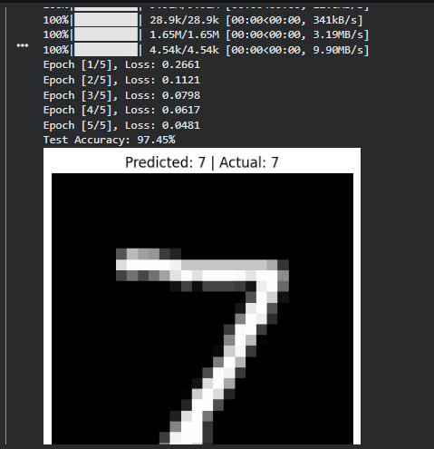

# MNIST Handwritten Digit Classifier using PyTorch

A beginner-friendly deep learning project that classifies handwritten
digits (0--9) using a fully connected neural network built with
**PyTorch** and the **MNIST dataset**.

## Results

-   **Test accuracy:** 97.45%
-   **Training epochs:** 5
-   **Final training loss:** 0.0481
-   **Example prediction:** 7
-   **Actual label:** 7



*The screenshot above shows a correctly classified handwritten digit:
the model predicted 7, and the actual label was 7.*

## Tech Stack

-   Python
-   PyTorch
-   Torchvision
-   Matplotlib
-   MNIST dataset

## Model Architecture

The model is a fully connected neural network:

1.  **Flatten:** Converts each 28 × 28 grayscale image into 784 input
    features.
2.  **Linear layer:** 784 → 128 neurons
3.  **ReLU activation**
4.  **Linear layer:** 128 → 64 neurons
5.  **ReLU activation**
6.  **Output layer:** 64 → 10 scores, one for each digit (0--9)

The model uses `CrossEntropyLoss` as its loss function and the Adam
optimizer for training.

## Installation

Make sure Python is installed, then install the required libraries:

``` bash
pip install torch torchvision matplotlib
```

## Run the Project

1.  Clone this repository:

    ``` bash
    git clone https://github.com/YOUR-USERNAME/YOUR-REPOSITORY.git
    ```

2.  Move into the project directory:

    ``` bash
    cd YOUR-REPOSITORY
    ```

3.  Run the Python script:

    ``` bash
    python mnist_classifier.py
    ```

The script downloads the MNIST dataset on the first run, trains the
model, evaluates test accuracy, displays a sample prediction, and saves
the trained weights to `mnist_model.pth`.

> Replace `YOUR-USERNAME` and `YOUR-REPOSITORY` with your GitHub
> username and repository name.

## How It Works

-   **Data loading:** `torchvision.datasets.MNIST` downloads and loads
    the training and test datasets.
-   **Preprocessing:** Images are converted to tensors and normalized.
-   **Training:** The model performs forward propagation, calculates
    loss, backpropagates gradients, and updates its weights.
-   **Evaluation:** Accuracy is calculated on the test dataset using
    `torch.no_grad()`.
-   **Prediction:** The class with the highest output score is selected
    using `argmax`.

## Project Structure

``` text
mnist-pytorch-classifier/
├── mnist_classifier.py
├── README.md
├── assets/
│   └── mnist-result.png
└── data/                 # Downloaded MNIST dataset (created at runtime)
```

The `data/` directory and the generated `mnist_model.pth` file are
created when you run the script; they do not need to be committed to
GitHub.

## Results Note

The reported **97.45% test accuracy** is from the run shown in the
screenshot. Results can vary slightly with different random
initialization, training settings, or software environments.

## Future Improvements

-   Build a CNN model to improve image feature extraction.
-   Add a web interface using Streamlit.
-   Allow users to upload their own handwritten digit images.
-   Display a confusion matrix and per-class evaluation metrics.

## License

This project is available for learning and educational use. Add a
license file if you want to specify reuse and distribution terms.
